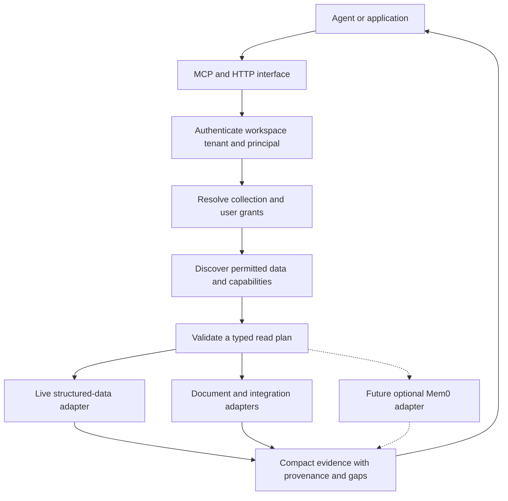
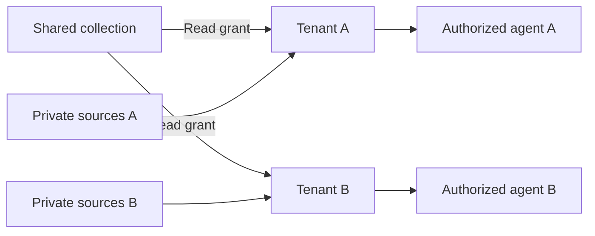

# Fabric

A lightweight context layer for AI applications that work with shared knowledge and private customer data. Built by **Altys**, the team behind [Loop CRM](https://github.com/shlok97/loop-crm).

Connect an agent to the right data, preserve who can see it, and return evidence it can cite. Keep large numerical datasets in their source systems. Retrieve relevant documents and optional conversational memory alongside them.

**Local POC · Python 3.11+ · SQLite · Optional on-device embeddings**

> The local implementation includes a fictional two-tenant demo, dashboard, authenticated HTTP API, stdio MCP server, read-only SQLite source adapter, incremental folder connector, keyword/semantic/hybrid document retrieval, and access/lifecycle tests. It is a development POC. Production Postgres RLS, hosted authentication, Mem0, Jev, Gmail and GitHub connectors remain future work.

[Quick start](#quick-start) · [Use with Claude](#use-with-your-existing-agent) · [Architecture](#architecture) · [Tenants](#tenants-and-shared-data) · [Mem0](#what-we-build-and-what-we-reuse) · [Validation](#validation) · [Roadmap](#roadmap)

## Quick start

Clone the repository and start the fictional demo:

```sh
git clone https://github.com/shlok97/fabric.git
cd fabric
python3 scripts/start.py
```

Open **http://127.0.0.1:4790** and paste a credential printed by the launcher. The launcher finds an already installed Python 3.11+ when the system Python is older. It downloads nothing. No API key, Docker, database server, frontend build, or third-party package is needed for keyword retrieval and live numeric reads.

The demo has **Alice and Bob at Paper Kite**, **Chandra at Cedar House**, a shared market collection, two private research collections, an Alice-only collection, and an ungranted licensed collection. All people, businesses, financial observations and messages are fictional. Sources and credentials live under ignored `data/demo/`. Restarting preserves them.

Try these flows:

1. Sign in as Alice. Search `Northstar revenue capacity` to retrieve shared and permitted private passages with source lines and content hashes.
2. Discover `revenue estimate`. Read `market.revenue` for `NORTHSTAR`, `FY2026`, `consolidated`: **120 INR crore**. Read `kite.estimate`: **110 INR crore**.
3. Try `cedar.estimate` as Alice. Fabric returns the same unavailable response as an unknown descriptor. Sign in as Chandra to read **135 INR crore** from her own source.
4. Try `market.dividend`: null remains unavailable. `market.roe` stays a fraction. Use a cutoff of `2026-05-10T00:00:00Z` to read the earlier fictional revenue vintage of **115**.
5. Revalidate a citation after changing its source or revoking its collection grant. Fabric refuses stale or unauthorized evidence.

Use `python3 scripts/start.py 4792` for a different port. Stop with **Ctrl+C**. The server binds only to `127.0.0.1`; it is not a hosted service.

[View the verified local demo](docs/images/local-demo.jpg).

### Add local semantic retrieval

Keyword retrieval is the baseline. Optional [FastEmbed](https://qdrant.github.io/fastembed/Getting%20Started/) runs BGE-small on the CPU and generates 384-dimensional document/query embeddings locally. Source text is not uploaded. The first explicit download fetches model artifacts; subsequent serving uses local files only.

With [uv](https://docs.astral.sh/uv/), use the committed dependency lock:

```sh
uv sync --extra mcp --extra dev --extra semantic
uv run --no-sync python -m fabric embed --download-model
uv run --no-sync python -m fabric --semantic serve
```

Stop the basic launcher before starting a second server on the same port. Select **Hybrid** or **Semantic** in the dashboard. Try `manufacturing facilities increased turnover`: the fixture's matching filing uses `capacity expansion` and `revenue`, so keyword search has no hit while semantic search retrieves it.

The model cache lives in ignored `data/models/bge-small`. We pin FastEmbed and record weight/tokenizer hashes in the vector model identifier. Only missing current-passage/model vectors are generated. Numerical rows are never embedded. This CPU implementation scans at most 5,000 authorized vectors per request; it is a small-corpus reference, not a large ANN index.

## Why Fabric

An AI application may need a customer's private spreadsheet, current records from a database, a shared knowledge base, and a decision buried in a conversation to answer one question.

Each source needs a different kind of access. A database should filter and aggregate its own records. A document needs a retrievable passage and a source locator. A remembered preference needs an owner and a lifecycle. A shared dataset needs explicit entitlements. Putting all of them into one vector index does not settle those differences.

Fabric gives agents a small evidence interface across these sources. The agent discovers available data, requests a bounded read, and receives results with source references, dates, and gaps. The application keeps control of identity, access, and execution budgets.

The first hypothesis is straightforward: this preparation should help an agent answer recurring questions more accurately or with less repeated retrieval work than direct integrations alone. We intend to test that before expanding the connector list.

## Who it is for

The initial audience is developers building AI applications for multiple customer organizations, especially where those applications combine common domain knowledge with private customer systems.

- **B2B SaaS teams** building support, account, or operations assistants.
- **Research and analytics teams** combining numerical datasets with private documents and source evidence.
- **AI application developers** who want the same data-access rules across interactive agents and background workflows.

If an agent with existing tools already solves your workflow reliably, Fabric needs to demonstrate a measurable improvement to earn a place in your stack.

## Use cases

These are target workflows; the local demo exercises the research pattern with fictional data. Production connectors are not shipped for every source listed here.

| Workflow | Shared context | Private context | Expected result |
|---|---|---|---|
| Customer support | Product documentation and release notes | The customer's account records and support history | An answer grounded in the right account and product version |
| Research | Common market observations and public filings | A client's estimates, notes, and assumptions | A comparison with compatible periods, units, and cited evidence |
| Account preparation | Approved product information | Permitted conversations, commitments, and open issues | A briefing that distinguishes confirmed facts from unresolved questions |
| Engineering investigation | Team-approved documentation and code references | Restricted incident or customer evidence | A source-backed explanation of what changed and what still needs checking |

### One question, two clients

Imagine a fictional research application serving **Paper Kite** and **Cedar House**. Both clients can read an approved collection of company results. Each has its own estimates and research notes.

An analyst at Paper Kite asks:

> How do our estimates compare with the latest reported results, and what explains the difference?

The intended flow is to read Paper Kite's permitted observations, fetch compatible reported figures from the shared collection, and retrieve relevant source passages. A missing estimate stays unavailable. A mismatch in fiscal period or reporting basis stays visible.

Cedar House can ask the same question against its own private inputs. It cannot discover Paper Kite's notes, estimates, or generated comparison. An answer containing private inputs remains private even when it also uses shared data.

All names and scenarios in this README are fictional.

## Architecture



The running local version uses one Python process and SQLite for Fabric state, FTS5 and optional document vectors. Numeric sources are separate SQLite databases opened in read-only mode. A browser workbench helps inspect evidence; there is no second chat runtime or mandatory answer-generation call.

The earlier production-oriented design proposed Postgres with RLS and pgvector. SQLite makes the POC runnable without Docker, but authorization is enforced by the gateway rather than database row policies. One workspace per state database is supported. A production multi-workspace service needs an independently tested authentication and database isolation layer.

The caller's agent chooses among permitted operations and writes the final answer. Fabric returns evidence directly, avoiding an obligatory second answer-generation call inside the gateway.

### Request lifecycle

1. **Authenticate.** Resolve the workspace, tenant membership, user or service identity, and current access.
2. **Discover.** Search a small catalog of permitted datasets, definitions, and available operations.
3. **Validate.** Check a typed plan against supported selectors, source permissions, dates, and execution limits.
4. **Retrieve.** Run bounded source reads, document search, and optional memory recall.
5. **Assemble.** Return useful evidence with units, source versions, citations, and explicit coverage gaps.

Source content is treated as data. Instructions inside an email or document cannot expand the caller's access or authorize a tool operation.

## Tenants and shared data

Fabric's intended access model has three main boundaries:

| Concept | Meaning |
|---|---|
| **Workspace** | The SaaS company or operator using Fabric |
| **Tenant** | A client organization whose private context must remain isolated |
| **Collection** | An owned group of sources or memories with explicit access grants |

Users and service identities operate within authorized tenants. Collections can hold private tenant resources, workspace resources, or deliberately published common knowledge.



Shared does not automatically mean public. Product documentation might be available to all clients; a licensed dataset might be available only to selected tenants. Internal company email might remain staff-only. Common knowledge is stored or connected once and exposed through grants.

The local implementation enforces these retrieval rules:

- Random bearer credentials map to a server-owned workspace, tenant and principal. Credentials are hashed in state; active identity is checked on every operation.
- A missing tenant never falls back to unrestricted or public access.
- User-level restrictions still apply within a tenant.
- Discovery, keyword/vector search, numeric reads and citation revalidation apply current collection and principal restrictions. Tool arguments cannot select a different owner, path, SQL string or tenant.
- Shared collection ownership alone grants nothing. Tenant-owned collections cannot receive cross-tenant grants through bootstrap.
- Revoking a grant or disabling a principal/source blocks subsequent retrieval. Updating or deleting a document invalidates its old citations; numeric citations are checked against the source again.
- Matching names, company IDs, or email domains do not create permission to share.

There are no generated-answer, memory or export endpoints yet. Future derived artifacts must inherit the intersection of their input permissions. Inactive document versions and vectors remain in local storage for audit; removal from retrieval is not a physical-erasure guarantee. Local operators with filesystem access are trusted. The tests establish POC behavior, not a production security certification.

## Working with large databases

The POC indexes descriptions and selected documents, and queries numeric rows at their source.

| Source | Current approach |
|---|---|
| Dataset and measure definitions | Lexical discovery over registered descriptors; stable IDs, units and versions |
| Numerical observations | Parameterized, read-only source SQL; exact subjects, period, basis and cutoff; producer-provided vintages |
| Long time series | Not supported yet; request exact periods rather than dumping a series |
| Documents | FTS5 BM25, optional local cosine search, or reciprocal-rank fusion; authorization before vector ranking |
| Conversations worth remembering | Future Mem0 adapter; no implicit memory writes |

Catalog embeddings can be added if evaluation shows they improve discovery. Whole-database embedding is outside the POC.

Numeric reads accept at most 20 subject IDs and 100 returned rows, use a 3-second SQLite progress deadline and open the source in read-only/query-only mode. A missing source or incompatible unit is an explicit failure. The source should have an index on `(subject, metric, period, basis, available_from)`; limiting output alone does not avoid an expensive scan.

The portable demo source contract is a `facts` table with those columns plus `value` and `unit`. It selects the latest eligible vintage for an exact period and basis. It is not an implementation of Altys financial formulas or historical serving semantics. A real domain adapter should use its producer-owned reader.

## Freshness and source evidence

Structured data is read on demand. A fresh query still reflects the source system's own update schedule. Evidence carries the fiscal period, availability clock, observed-at timestamp, source ID and freshness state. Captured sources can be marked `captured_snapshot` rather than falsely advertised as live; partial snapshots refuse historical-vintage queries.

The folder connector reads selected UTF-8 `.md`/`.txt` files, stores source-relative paths and line locators, hashes content, and changes only modified/deleted documents. Unchanged passages retain citations and vectors. A failed scan preserves the last successful snapshot and exposes an error. Hidden files and symlinks are skipped. A pass is capped at 1,000 files, 10 MiB total, 256 KiB per file and a 10-second scan deadline.

```sh
python -m fabric sync kite-docs
python -m fabric watch kite-docs --interval 30
```

`watch` is an explicit foreground poller; it installs no background job. Changes become keyword-searchable after the next successful scan. For semantic coverage, run `python -m fabric embed` after sync; stale/deleted vectors are excluded immediately even before the next embedding pass. There is no webhook/CDC guarantee yet.

Gmail/GitHub OAuth, webhooks, provider cursors and reconciliation are future adapters. They are not represented by working connectors in this POC.

The evidence contract includes:

| Field | Purpose |
|---|---|
| Source reference and version | Identify the exact supporting record or document |
| Locator | Point to a page, passage, source row, or other precise location |
| Units and selectors | Preserve what a numerical observation actually represents |
| Observation and availability dates | Distinguish the period described from when it became knowable |
| Retrieval mode | Identify live reads, indexed evidence, or recalled memory |
| Coverage and status | Show missing, partial, stale, unsupported, or unavailable results |

An empty search result cannot establish that a fact was never disclosed. Remembered statements cannot replace authoritative live observations. Fabric should expose these distinctions to the answering agent.

## What we build and what we reuse

Fabric's scope is evidence access across shared and private sources. Conversational memory is an optional component.

| Capability | Intended owner |
|---|---|
| Workspace and tenant authorization | Fabric |
| Shared collection grants and upstream identity binding | Fabric |
| Catalog discovery and typed read-plan validation | Fabric |
| Source adapters and evidence packaging | Fabric, reusing existing source APIs and readers |
| Document embeddings | FastEmbed / BGE-small, optional local execution |
| Durable conversational fact extraction and recall | Mem0, future integration |
| Memory embedding and retrieval backend | Mem0 with configured providers, future integration |
| Eligibility and revocation across source-derived context | Fabric |
| Optional semantic claim verification | Jev, future integration |
| End-to-end evaluation and execution receipts | Fabric |

### Mem0

[Mem0](https://docs.mem0.ai/core-concepts/how-it-works) provides memory extraction, storage, and retrieval for information worth carrying across interactions. We plan to reuse those operations rather than build another conversational memory engine.

The first memory experiment will use self-hosted Mem0 behind a replaceable adapter, with development storage separate from source databases. Fabric will own the authenticated scope and determine which content is eligible to enter or leave the memory backend.

Mem0's managed and open-source editions have different capabilities and administration models. The integration will pin and qualify an actual release instead of assuming feature parity. See [Mem0 Platform versus Open Source](https://docs.mem0.ai/platform/platform-vs-oss).

Memory remains optional and is not implemented in this release. The working evidence path does not recreate Mem0's fact extraction, consolidation or conversational recall. Before enabling private memory, we need separate backing namespaces/history and source eligibility checks before both extraction and recall; a post-filter cannot undo unauthorized content sent to a model.

### Jev

[Jev](https://docs.typesafe.ai/introduction) is a candidate for narrow semantic checks, such as whether a supplied passage supports a claim. Its integration is planned as optional.

Authorization, numerical calculations, date comparisons, and exact source matching belong in deterministic application logic. A judge's confidence is not proof that a claim is correct. Jev will be evaluated separately after the evidence-retrieval baseline is established.

## Use with your existing agent

Fabric exposes the same evidence operations through HTTP and stdio MCP. Install the optional MCP extra (`uv sync --extra mcp`) and supply one credential through the process environment or a private token file:

```sh
export FABRIC_TOKEN_FILE=/absolute/path/to/private/alice-token.txt
claude mcp add --transport stdio fabric -- "/absolute/path/to/fabric/.venv/bin/python" \
  -m fabric --db "/absolute/path/to/fabric/data/demo/fabric.db" mcp
```

The token file contains just that principal's token, not the complete demo credentials JSON. Use the same absolute state path as the dashboard. Run the command from the Fabric checkout; an installed package also works from other directories. Environment variables must be present when the client launches the process. To enable local semantic search, put `--semantic --model-cache /absolute/path/to/fabric/data/models/bge-small` before `mcp`.

Tools are `fabric_status`, `fabric_discover`, `fabric_read`, `fabric_search`, and `fabric_get_evidence`. There is no tool to provision identities, grant access, ingest arbitrary paths, run SQL, write a source, or approve memory. The stdio SDK round trip is tested; an authenticated Claude model run is a separate evaluation.

HTTP uses `POST /api/call`, a bearer header, and a strict operation envelope:

```sh
curl http://127.0.0.1:4790/api/call \
  -H "Authorization: Bearer $FABRIC_TOKEN" -H 'Content-Type: application/json' \
  -d '{"operation":"search","arguments":{"query":"Northstar capacity","strategy":"hybrid","limit":3}}'
```

Each response includes evidence, gaps and a content-free receipt. Requests are capped at 16 KiB and responses at 32 KiB; passage reads do not paginate. Narrow the request when it exceeds a limit. Token estimates use a byte-based heuristic, not a provider tokenizer. External model cost is zero for these local operations; CPU, RAM, disk and eventual answering-agent costs are separate.

Cloud agents and direct integrations are a strong baseline. Fabric's proposed contribution is reusable source interpretation, scoped retrieval, and evidence packaging. Those benefits have to be measured; another service is not automatically an improvement.

There is no hosted Fabric endpoint or published SDK/package yet.

## Keeping the POC small

The local implementation uses:

- One Python service, SQLite metadata and separate read-only source files.
- A small catalog and a few explicitly selected source adapters.
- Tenant-private collections and explicitly granted shared collections.
- Bounded reads with clear errors and partial-result status.
- Optional CPU embeddings; no mandatory model or vector server.

A separate graph database, distributed queue, Redis cache, broad connector marketplace, and new chat application are outside the first release. Answer caching starts disabled so that permission changes and source updates do not introduce an additional invalidation problem.

## Connect your own selected sources

Bootstrap a separate local state database with a private JSON config. See [the example config](examples/config.json) and [source/setup contract](docs/architecture.md). Use absolute paths and one collection per access boundary.

```sh
python -m fabric --db data/my-workspace/fabric.db init /absolute/path/to/config.local.json
python -m fabric --db data/my-workspace/fabric.db sync my-documents
python -m fabric --db data/my-workspace/fabric.db serve --port 4792
```

`init`, `sync`, `watch`, `embed`, `revoke` and `disable-principal` are local-operator CLI commands, not agent-facing tools. `init` refuses an already provisioned workspace. Source database credentials and production API tokens are not needed for the demo and are never loaded from a sibling project.

```sh
python -m fabric revoke shared paper-kite
python -m fabric disable-principal alice
```

The next authenticated operation uses the changed grants/identity. There is no default public tenant and no anonymous data route.

## Validation

The first local validation ran on 21 October 2026. **73 tests passed**, including real offline embedding inference, HTTP requests, a real MCP stdio client/server round trip, access attacks, source updates/deletes, and grant/identity revocation. No model API key was used.

```sh
uv sync --extra mcp --extra dev --extra semantic
uv run --no-sync pytest -q
FABRIC_TEST_MODEL_CACHE="$PWD/data/models/bge-small" uv run --no-sync pytest -q
uv run --no-sync python scripts/evaluate.py --model-cache data/models/bge-small
```

The first test command skips the six optional model-dependent cases unless the cache variable is set. The second uses already downloaded weights and does not download them. The evaluation reports 31 deterministic checks plus warm retrieval timings over the fictional corpus and a source database with 100,000 additional rows. Local receipts are under ignored `reports/local/`. See [validation results and limits](docs/validation.md).

A bounded Altys sample was tested separately using three current-view observations and a source-owned catalog definition. Values, nulls, fraction units and access denial survived the local snapshot path. That is not live customer integration, historical PIT certification, or an audit of financial correctness. Customer content, configuration and Altys receipts stay outside this public repository.

The next product experiment must compare the same agent and model across four setups:

| Setup | What it tests |
|---|---|
| Direct tools | A capable agent using existing readers and reviewed instructions |
| Direct tools plus Mem0 | The contribution of conversational memory |
| Fabric without memory | The contribution of scoped discovery and evidence assembly |
| Fabric plus Mem0 | Whether the combination adds value over either component |

The planned 60-case pilot covers shared numerical data, private-plus-shared questions, document evidence, operational context, memory, ambiguity, access attacks, and source lifecycle failures. Cases will use frozen source references and independently defined expected outcomes.

We will measure supported-answer success, unsupported claims, evidence recall, access failures, tool calls, tokens, cost, and end-to-end latency. Human review and deterministic source checks define correctness; a model judge does not grade its own success.

Local retrieval and isolation tests pass. The four-arm answer-quality comparison has not run; no advantage over Claude Code, direct tools or Mem0 has been established. The installed Claude CLI was signed out during the first local validation. In the tiny fixture, a provenance-rich retrieved bundle can even exceed the byte size of all authorized raw passage text, so these diagnostics do not establish token savings.

## Roadmap

- [x] Define the initial product scope, tenancy model, and evidence flow.
- [x] Publish the project introduction and visual identity.
- [x] Add synthetic two-tenant fixtures and deterministic retrieval diagnostics.
- [x] Implement local credentials, collection grants, and isolation tests.
- [x] Add catalog discovery and bounded read-only structured-data reads.
- [x] Add incremental folder sync and citation revalidation.
- [x] Add optional local embeddings and hybrid retrieval.
- [x] Expose the evidence interface through MCP and HTTP.
- [ ] Qualify producer-owned live Altys readers and user-bound customer sources.
- [ ] Add Postgres RLS and hosted authentication before production multi-tenant use.
- [ ] Integrate optional Mem0 and qualify its scope and lifecycle behavior.
- [ ] Compare against direct tools and publish a reproducible evaluation.
- [ ] Add narrow GitHub and Gmail adapters where the evaluation supports them.
- [ ] Freeze and run the full 60-case agent evaluation.
- [x] Publish the initial implementation and synthetic demo.

The sequence is deliberate: establish isolation and useful evidence retrieval before expanding integrations or adding more infrastructure.

## Get involved

We are interested in concrete workflows from teams building agents over a mixture of shared and private data.

[Open an issue](https://github.com/shlok97/fabric/issues) with the question your agent needs to answer, the source types involved, the access boundaries, and what your current approach gets wrong. Use fictional examples and public information. Keep customer records, credentials, and private messages out of issues.

Focused contributions around adapters, scoped retrieval, evidence quality, and reproducible evaluation will be useful. See [the contributor guide](CONTRIBUTING.md). Keep real workspace data and local model caches out of Git.

---

Built by **Altys**. From the team behind [Loop CRM](https://github.com/shlok97/loop-crm).

The banner follows the same Indian editorial painting direction: warm sandstone, indigo, honey sunlight, and a shared working table. The people and setting are fictional.
