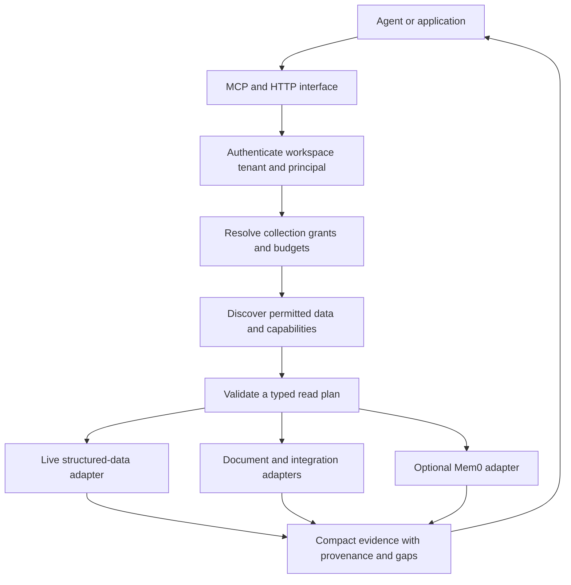
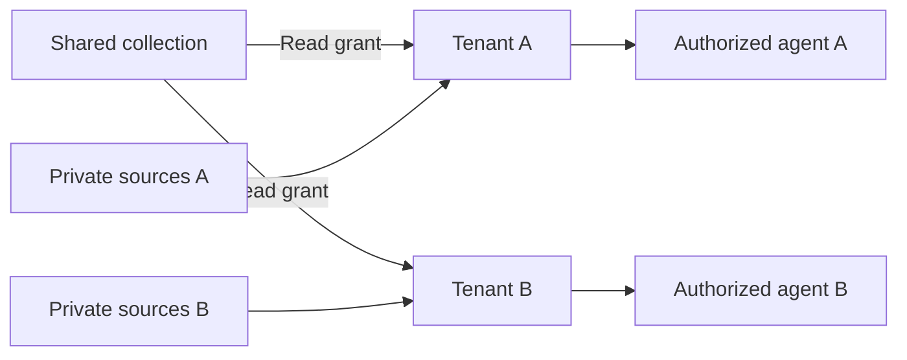

# Fabric

A lightweight context layer for AI applications that work with shared knowledge and private customer data. Built by **Altys**, the team behind [Loop CRM](https://github.com/shlok97/loop-crm).

Connect an agent to the right data, preserve who can see it, and return evidence it can cite. Keep large numerical datasets in their source systems. Retrieve relevant documents and optional conversational memory alongside them.

**Coming soon · Design stage · Open-source implementation planned**

> This repository currently contains the project README and artwork. The service, adapters, SDK, demo, and isolation tests have not been implemented. The architecture below describes the intended POC; there is no package to install or production endpoint to connect to yet.

[Why Fabric](#why-fabric) · [Use cases](#use-cases) · [Architecture](#planned-architecture) · [Tenants and shared data](#tenants-and-shared-data) · [Mem0](#what-we-build-and-what-we-reuse) · [Roadmap](#roadmap)

## Why Fabric

An AI application may need a customer's private spreadsheet, current records from a database, a shared knowledge base, and a decision buried in a conversation to answer one question.

Each source needs a different kind of access. A database should filter and aggregate its own records. A document needs a retrievable passage and a source locator. A remembered preference needs an owner and a lifecycle. A shared dataset needs explicit entitlements. Putting all of them into one vector index does not settle those differences.

Fabric is being designed to give agents a small, consistent evidence interface across these sources. The agent discovers available data, requests a bounded read, and receives results with source references, dates, and gaps. The application keeps control of identity, access, and execution budgets.

The first hypothesis is straightforward: this preparation should help an agent answer recurring questions more accurately or with less repeated retrieval work than direct integrations alone. We intend to test that before expanding the connector list.

## Who it is for

The initial audience is developers building AI applications for multiple customer organizations, especially where those applications combine common domain knowledge with private customer systems.

- **B2B SaaS teams** building support, account, or operations assistants.
- **Research and analytics teams** combining numerical datasets with private documents and source evidence.
- **AI application developers** who want the same data-access rules across interactive agents and background workflows.

If an agent with existing tools already solves your workflow reliably, Fabric needs to demonstrate a measurable improvement to earn a place in your stack.

## Use cases

These are proposed workflows, not shipped features.

| Workflow | Shared context | Private context | Expected result |
|---|---|---|---|
| Customer support | Product documentation and release notes | The customer's account records and support history | An answer grounded in the right account and product version |
| Research | Common market observations and public filings | A client's estimates, notes, and assumptions | A comparison with compatible periods, units, and cited evidence |
| Account preparation | Approved product information | Permitted conversations, commitments, and open issues | A briefing that distinguishes confirmed facts from unresolved questions |
| Engineering investigation | Team-approved documentation and code references | Restricted incident or customer evidence | A source-backed explanation of what changed and what still needs checking |

### One question, two clients

Imagine a fictional research application serving **Paper Kite** and **Cedar House**. Both clients can read an approved collection of company results. Each has its own estimates and research notes.

An analyst at Paper Kite asks:

> How do our estimates compare with the latest reported results, and what explains the difference?

The intended flow is to read Paper Kite's permitted observations, fetch compatible reported figures from the shared collection, and retrieve relevant source passages. A missing estimate stays unavailable. A mismatch in fiscal period or reporting basis stays visible.

Cedar House can ask the same question against its own private inputs. It cannot discover Paper Kite's notes, estimates, or generated comparison. An answer containing private inputs remains private even when it also uses shared data.

All names and scenarios in this README are fictional.

## Planned architecture

The initial deployment target is one Python service and a dedicated Postgres database for Fabric metadata, full-text search, and optional vector storage. Existing databases and document stores remain the source of their own records.

The caller's agent chooses among permitted operations and writes the final answer. Fabric returns evidence directly, avoiding an obligatory second answer-generation call inside the gateway.

### Request lifecycle

1. **Authenticate.** Resolve the workspace, tenant membership, user or service identity, and current access.
2. **Discover.** Search a small catalog of permitted datasets, definitions, and available operations.
3. **Validate.** Check a typed plan against supported selectors, source permissions, dates, and execution limits.
4. **Retrieve.** Run bounded source reads, document search, and optional memory recall.
5. **Assemble.** Return useful evidence with units, source versions, citations, and explicit coverage gaps.

Source content is treated as data. Instructions inside an email or document cannot expand the caller's access or authorize a tool operation.

## Tenants and shared data

Fabric's intended access model has three main boundaries:

| Concept | Meaning |
|---|---|
| **Workspace** | The SaaS company or operator using Fabric |
| **Tenant** | A client organization whose private context must remain isolated |
| **Collection** | An owned group of sources or memories with explicit access grants |

Users and service identities operate within authorized tenants. Collections can hold private tenant resources, workspace resources, or deliberately published common knowledge.

Shared does not automatically mean public. Product documentation might be available to all clients; a licensed dataset might be available only to selected tenants. Internal company email might remain staff-only. Common knowledge is stored or connected once and exposed through grants.

The intended rules are:

- Credentials and verified membership establish access. A tenant ID supplied by a model or caller is only a requested scope.
- A missing tenant never falls back to unrestricted or public access.
- User-level restrictions still apply within a tenant.
- Search, direct reads, citation links, continuation, memory, exports, and background jobs enforce the same scope.
- Private inputs keep derived answers and memories private to their permitted audience.
- Revoking a grant blocks dependent retrieval; deleting a source requires handling its derived memories and summaries too.
- Matching names, company IDs, or email domains do not create permission to share.

These are design requirements. They will need implementation and adversarial testing before use with real private clients.

## Working with large databases

The POC will index descriptions of data and available operations rather than embedding each numerical row.

| Source | Intended approach |
|---|---|
| Dataset and measure definitions | Search a small, versioned catalog; begin with lexical search and reviewed aliases |
| Numerical observations and account records | Read through approved adapters, with filtering and aggregation in the source system |
| Long time series | Request a bounded period, projection, or supported aggregate |
| Documents | Retrieve selected passages and exact source references |
| Conversations worth remembering | Store approved durable memories through the optional memory adapter |

Catalog embeddings can be added if evaluation shows they improve discovery. Whole-database embedding is outside the POC.

Adapters must enforce execution time, concurrency, result size, and supported operations. Limiting returned rows alone does not prevent an expensive database scan. The first adapters will use existing registered readers rather than unrestricted generated SQL.

## Freshness and source evidence

Structured data is intended to be read on demand. A fresh query still reflects the source system's own update schedule, so evidence needs observation dates and an explicit freshness state.

Documents and integration records need source versions or hashes, last successful checks, and visible readiness. The first GitHub and Gmail adapters are planned as narrow live reads. Background indexing would follow only where repeated use justifies it, with change tracking, deletion handling, and reconciliation.

The evidence contract is intended to include:

| Field | Purpose |
|---|---|
| Source reference and version | Identify the exact supporting record or document |
| Locator | Point to a page, passage, source row, or other precise location |
| Units and selectors | Preserve what a numerical observation actually represents |
| Observation and availability dates | Distinguish the period described from when it became knowable |
| Retrieval mode | Identify live reads, indexed evidence, or recalled memory |
| Coverage and status | Show missing, partial, stale, unsupported, or unavailable results |

An empty search result cannot establish that a fact was never disclosed. Remembered statements cannot replace authoritative live observations. Fabric should expose these distinctions to the answering agent.

## What we build and what we reuse

Fabric's scope is evidence access across shared and private sources. Conversational memory is an optional component.

| Capability | Intended owner |
|---|---|
| Workspace and tenant authorization | Fabric |
| Shared collection grants and upstream identity binding | Fabric |
| Catalog discovery and typed read-plan validation | Fabric |
| Source adapters and evidence packaging | Fabric, reusing existing source APIs and readers |
| Durable conversational fact extraction and recall | Mem0 |
| Memory embedding and retrieval backend | Mem0 with configured providers |
| Eligibility and revocation across source-derived context | Fabric |
| Optional semantic claim verification | Jev |
| End-to-end evaluation and execution receipts | Fabric |

### Mem0

[Mem0](https://docs.mem0.ai/core-concepts/how-it-works) provides memory extraction, storage, and retrieval for information worth carrying across interactions. We plan to reuse those operations rather than build another conversational memory engine.

The first memory experiment will use self-hosted Mem0 behind a replaceable adapter, with development storage separate from source databases. Fabric will own the authenticated scope and determine which content is eligible to enter or leave the memory backend.

Mem0's managed and open-source editions have different capabilities and administration models. The integration will pin and qualify an actual release instead of assuming feature parity. See [Mem0 Platform versus Open Source](https://docs.mem0.ai/platform/platform-vs-oss).

Memory will remain optional. The baseline evidence path must work without it, and evaluation must show whether adding memory improves the selected workflow.

### Jev

[Jev](https://docs.typesafe.ai/introduction) is a candidate for narrow semantic checks, such as whether a supplied passage supports a claim. Its integration is planned as optional.

Authorization, numerical calculations, date comparisons, and exact source matching belong in deterministic application logic. A judge's confidence is not proof that a claim is correct. Jev will be evaluated separately after the evidence-retrieval baseline is established.

## Use with your existing agent

Fabric is intended to be callable through MCP or HTTP from Claude Code, another agent runtime, or an application backend. The same permitted evidence should be available across those entry points.

Cloud agents and direct integrations are a strong baseline. Fabric's proposed contribution is reusable source interpretation, scoped retrieval, and evidence packaging. Those benefits have to be measured; another service is not automatically an improvement.

There is no Fabric MCP server, SDK, hosted service, or connection command available in this repository yet.

## Keeping the POC small

The first implementation is intended to use:

- One Python service and one dedicated Postgres instance.
- A small catalog and a few explicitly selected source adapters.
- Tenant-private collections and explicitly granted shared collections.
- Bounded reads with clear errors and partial-result status.
- Optional Mem0 and Jev adapters, enabled only for the experiments that need them.

A separate graph database, distributed queue, Redis cache, broad connector marketplace, and new chat application are outside the first release. Answer caching starts disabled so that permission changes and source updates do not introduce an additional invalidation problem.

## Validation

The first internal evaluation is planned at Altys. Customer content, private configuration, source inventories, and internal evaluation receipts will remain outside this public repository.

The proposed experiment compares the same agent and model across four setups:

| Setup | What it tests |
|---|---|
| Direct tools | A capable agent using existing readers and reviewed instructions |
| Direct tools plus Mem0 | The contribution of conversational memory |
| Fabric without memory | The contribution of scoped discovery and evidence assembly |
| Fabric plus Mem0 | Whether the combination adds value over either component |

The planned 60-case pilot covers shared numerical data, private-plus-shared questions, document evidence, operational context, memory, ambiguity, access attacks, and source lifecycle failures. Cases will use frozen source references and independently defined expected outcomes.

We will measure supported-answer success, unsupported claims, evidence recall, access failures, tool calls, tokens, cost, and end-to-end latency. Human review and deterministic source checks define correctness; a model judge does not grade its own success.

Cross-tenant and same-tenant user isolation, source revocation, and visible failure behavior are required before private-client use. We have not published comparative results or established a performance advantage.

## Roadmap

- [x] Define the initial product scope, tenancy model, and evidence flow.
- [x] Publish the project introduction and visual identity.
- [ ] Freeze the evaluation cases and synthetic two-tenant fixtures.
- [ ] Implement authentication, collection grants, and isolation tests.
- [ ] Add catalog discovery and bounded structured-data reads.
- [ ] Add document retrieval and source-aware evidence bundles.
- [ ] Expose the evidence interface through MCP and HTTP.
- [ ] Integrate optional Mem0 and qualify its scope and lifecycle behavior.
- [ ] Compare against direct tools and publish a reproducible evaluation.
- [ ] Add narrow GitHub and Gmail adapters where the evaluation supports them.
- [ ] Publish the implementation, license, and synthetic demo.

The sequence is deliberate: establish isolation and useful evidence retrieval before expanding integrations or adding more infrastructure.

## Get involved

We are interested in concrete workflows from teams building agents over a mixture of shared and private data.

[Open an issue](https://github.com/shlok97/fabric/issues) with the question your agent needs to answer, the source types involved, the access boundaries, and what your current approach gets wrong. Use fictional examples and public information. Keep customer records, credentials, and private messages out of issues.

Once implementation begins, focused contributions around adapters, scoped retrieval, evidence quality, and reproducible evaluation will be useful.

---

Built by **Altys**. From the team behind [Loop CRM](https://github.com/shlok97/loop-crm).

The banner follows the same Indian editorial painting direction: warm sandstone, indigo, honey sunlight, and a shared working table. The people and setting are fictional.
