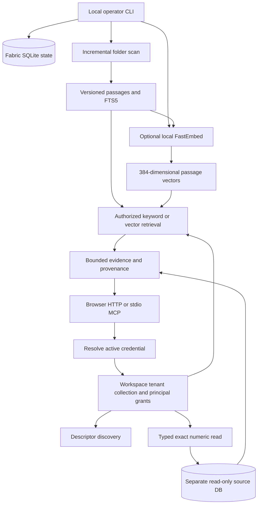

# Fabric 0.1 local architecture

The current POC implements scoped evidence retrieval. It does not generate answers, perform source writes, or extract memories.



## Trust boundaries

One state file is one workspace. Each credential resolves to one fixed tenant/principal. Token hashes are in the state database; generated plaintext keys are written only to an ignored local credentials file. Identity is rechecked for every HTTP, MCP and direct API operation. There is no model-supplied tenant selector or delegation API.

Collections belong to the workspace (`tenant=null`) or to one tenant. All reads require a grant. A tenant-level grant grants members access; a principal grant narrows it to one identity. A tenant-owned collection cannot be granted to another tenant during bootstrap. Document and source bindings may further restrict the principal. The effective audience is the intersection, never the union of these checks.

Keyword search joins permissions before LIMIT. Vector search loads only currently authorized, active passage vectors before cosine ranking, rather than searching all tenants and post-filtering. Source text is returned as data; there is no evaluator executing instructions inside it. An agent calling Fabric still needs its own prompt-injection controls.

Every evidence lookup rechecks access. Document references address an immutable passage of one content-hashed version and become unavailable when the document changes or disappears from the current index. Numeric references are private to the requesting principal, bind descriptor and source configuration versions, and requery the underlying source before returning. A revalidation does not recover an old value after source correction. Errors for missing/stale/unauthorized evidence are identical.

SQLite has no database RLS. A local operator with filesystem or process access is trusted. Tokens have no automatic expiry or rotation in this release; `disable-principal` invalidates the current key. Production deployment needs hosted authentication, credential lifecycle, database-enforced isolation, request admission limits, retention and backup policies, and independent review. Do not expose the built-in HTTP server publicly.

## State and source contracts

`fabric/schema.sql` defines principals, collections/grants, source connections, descriptors, document versions, passages/FTS5, vectors, numeric references and content-free request receipts. Changes are additive CREATE IF NOT EXISTS in 0.1; there is no general migration framework yet.

The `facts` source database is separate from Fabric state:

```sql
CREATE TABLE facts (
  subject TEXT, metric TEXT, period TEXT, basis TEXT,
  value REAL, unit TEXT, available_from TEXT
);
CREATE UNIQUE INDEX facts_key
  ON facts(subject,metric,period,basis,available_from);
```

`available_from` must be canonical UTC milliseconds, e.g. `2026-05-15T00:00:00.000Z`. Supported bases are `consolidated`, `standalone`, and `not_applicable`. The selected descriptor supplies metric/unit, the caller supplies exact subject IDs and period/basis, and the adapter selects one latest eligible vintage per subject. Ambiguous vintages and unit mismatches fail. Null stays unavailable. No financial formulas, aggregates or fallback reporting bases are reconstructed.

A source can define a server-owned subject allowlist. Source paths are configured by the operator, never accepted from agent arguments. SQLite is opened `mode=ro`, uses `query_only`, has a one-second lock timeout, and interrupts SQL after three seconds via a progress callback. The source index is necessary for large tables; this is not an arbitrary-database optimizer.

`config.snapshot` can identify a captured rather than live source, including capture time, source hash, original clocks and vintage-history limitations. The response then says `captured_snapshot`. The simple snapshot contract refuses reads earlier than the capture time. A partial current-view export cannot certify historical PIT behavior.

## Incremental ingestion and freshness

The folder connection supports UTF-8 `.md` and `.txt`, including source-relative line locators. It excludes hidden entries, symlink files and symlink directories. Entire-file SHA-256 identifies changes. Passages are at most 1,800 characters, split along lines where possible. Multiple pieces of a long line share that line number; the opaque passage ID distinguishes them.

The scan completes before any revision/deletion is committed. A connection reconfiguration during the scan aborts it. Successful syncs update only changed/new documents, deactivate missing/changed versions, and retain unchanged passage IDs. A failed scan leaves the previous searchable snapshot and exposes a generic last-error marker with the last successful sync time.

`watch` scans at an operator-selected interval of at least five seconds, in the foreground. Default 30-second polling is not a guaranteed 30-second source SLA. Actual freshness includes scan duration, failures, upstream writes and a separate embedding pass. There are no installed daemons, webhooks, CDC, GitHub/Gmail cursors, OCR or PDFs in this version.

Inactive source versions and vectors remain on disk but cannot be retrieved. Physical deletion/retention management is future work. There are no memory or answer artifacts to invalidate yet.

## Retrieval and embeddings

Lexical mode uses SQLite FTS5 BM25 with a bounded, escaped OR expression over at most 12 Unicode query terms. Descriptors use lexical matching over registered names/descriptions and remain separate from numeric records.

Optional FastEmbed 0.9.0 runs `BAAI/bge-small-en-v1.5` on one CPU thread. ONNX telemetry is disabled before model construction. We explicitly hash the actual ONNX/tokenizer/config artifacts into the model ID. Serving loads cached files only; `embed --download-model` is the explicit network-download operation. No remote inference, environment model key, or source text upload is used.

Embeddings are normalized 384-float vectors stored as BLOBs by `(passage_id, model_hash)`. The operator embeds only missing active passages for the current model. Changed documents get new passage IDs; old vectors are excluded from retrieval. A source sync does not silently trigger inference. New passages remain keyword-searchable until the next embedding pass.

Semantic retrieval uses exact cosine over at most 5,000 authorized vectors and a provisional 0.35 similarity threshold, not a support classifier. Hybrid retrieval fuses lexical and semantic ranks with reciprocal rank fusion (`k=60`). These defaults need relevance calibration on a representative corpus; semantic similarity can retrieve irrelevant passages. There is no cross-encoder, query rewrite, graph, answer cache or internal generation step.

For a large document corpus, replace the linear scan with an authorization-aware vector backend and benchmark filtered recall. Numerical database size does not increase this vector index: the 100,000-row diagnostic still embeds eight document passages and zero numeric rows.

## Limits and receipts

| Boundary | Local cap |
|---|---|
| HTTP request / response | 16 KiB / 32 KiB |
| Catalog descriptors | 20 |
| Document query | 500 characters, 12 terms, 12 returned passages |
| Numeric query | 20 exact subjects, 100 rows, one source call |
| Folder pass | 1,000 files, 10 MiB total, 256 KiB/file, 10 seconds scan |
| Embedding pass | 500 changed passages |
| Semantic search | 5,000 permitted vectors |

The POC has no multi-source automatic planner or agent-facing bundle operation, so each call reads one source or searches the selected index. Narrow an oversized request. There is no opaque pagination yet. HTTP Host and Origin checks guard the loopback UI, private API calls require a bearer header, and browser content uses text nodes rather than HTML injection. It has no CORS wildcard or public data endpoint.

Receipts store operation, principal, status, elapsed time, payload bytes, item count, successful source-call count and timestamp; no query, evidence text or bearer key. Failed requests use source_calls=-1 (unknown), rather than claiming no attempted call. Invalid credentials are denied without an identity receipt. Approximate context tokens are `(evidence_bytes+3)//4`; these are not actual tokenizer counts. External model calls/cost are zero for the implemented local operations, while CPU inference and the eventual caller agent have separate costs.

## What remains before product validation

Implement producer-owned live API readers and user-bound client sources; qualify permissions using actual served requests. Add Mem0 behind the gateway with isolated backing and history state, checked eligibility before extraction/recall, and tested deletion/revocation. Add Jev only for opt-in frozen-evidence claim checks. Run the controlled direct-tools/Mem0/Fabric benchmark using the same authenticated agent, source versions and budgets.

Do not infer those capabilities from a successful local retrieval test. See [validation](validation.md).
